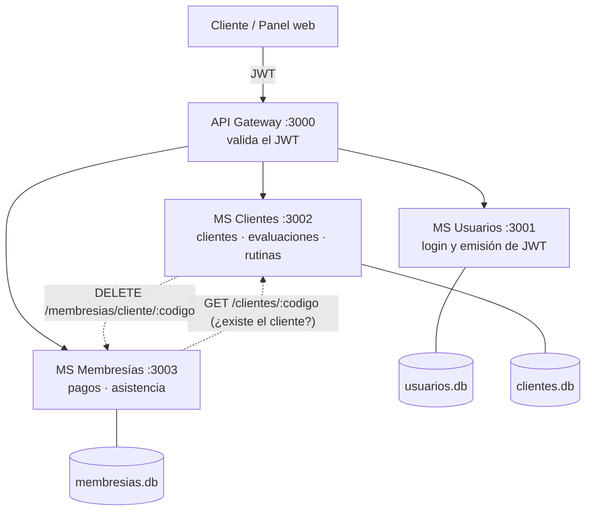
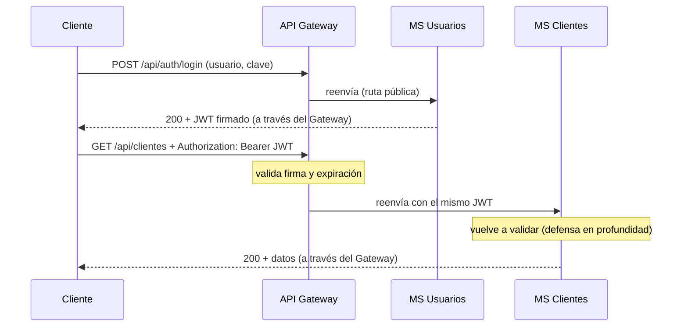

# Gym Microservicios — Sistema de gestión para entrenadores personales

> Proyecto Etapa 2 · Módulo **DevOps – WebApps** · Universidad de Manizales
> Evolución de un monolito Node.js/SQLite a una **arquitectura de microservicios en capas** con **API Gateway** y **autenticación JWT**.

---

## 1. Problema

Un entrenador personal (y su recepcionista) necesita llevar el control de sus clientes: datos personales, evaluaciones físicas, rutinas, pagos de planes y asistencia. Hacerlo en hojas de Excel genera:

- Datos duplicados y códigos de cliente mal escritos a mano.
- Ninguna separación de permisos: cualquiera que abra el archivo ve y edita los pagos.
- Imposibilidad de que dos personas trabajen a la vez desde lugares distintos.
- Riesgo de perder todo al dañarse un solo archivo.

## 2. Solución propuesta

Un sistema web con un panel de administración y una API REST dividida en **microservicios independientes**, cada uno con su propia base de datos y una responsabilidad clara. Un **API Gateway** es la única puerta de entrada y exige un **JWT válido** en todas las rutas salvo el login.

Dos roles:

| Acción | Admin (entrenador) | Asistente (recepción) |
|---|:---:|:---:|
| Ver todo | ✅ | ✅ |
| Crear / editar clientes, evaluaciones, rutinas, asistencia | ✅ | ✅ |
| Eliminar clientes | ✅ | ❌ |
| Crear / editar / eliminar **pagos** | ✅ | ❌ (solo lectura) |
| Gestionar usuarios del sistema | ✅ | ❌ |

## 3. Integrantes

| Integrante | Microservicio a cargo |
|---|---|
| _[Nombre 1]_ | `ms-usuarios` (autenticación y emisión del JWT) |
| _[Nombre 2]_ | `ms-clientes` (clientes, evaluaciones, rutinas) |
| _[Nombre 3]_ | `ms-membresias` (pagos y asistencia) + `api-gateway` (en conjunto) |

> Completar con los nombres reales del grupo.

## 4. Tecnologías utilizadas

- **Node.js 18+** y **Express 4** (servicios y gateway)
- **Axios** (comunicación Gateway → microservicios y entre microservicios)
- **JWT** (`jsonwebtoken`, algoritmo HS256) y **bcryptjs** (hash de contraseñas)
- **SQLite** (`better-sqlite3`), una base de datos por microservicio
- **npm workspaces** + **concurrently** (un solo `npm install` y un solo `npm start`)
- **Git / GitHub** (una rama por integrante, unión en `main`)
- Front-end: HTML + CSS + JavaScript puro (panel de administración, servido por el Gateway)

## 5. Arquitectura

### 5.1 Vista general



- **Base de datos por servicio:** ningún servicio lee la base de otro; si necesita un dato ajeno, lo pide por HTTP.
- **El Gateway valida el JWT y cada microservicio lo vuelve a validar** (defensa en profundidad): si alguien llama directamente al puerto 3002, también recibe 401.
- **El dashboard** lo arma el Gateway consultando en paralelo a `ms-clientes` y `ms-membresias` (composición de APIs).

### 5.2 Arquitectura por capas (dentro de cada microservicio)

```
Gateway
   │
   ▼
Routes ──► Controller ──► Service ──► Repository ──► Base de datos
 (URL +      (HTTP)      (reglas de     (SQL)          (SQLite)
 seguridad)               negocio)
                              Models: describen las tablas
```

| Capa | Responsabilidad | Lo que **NO** debe hacer |
|---|---|---|
| **Gateway** | Punto de entrada único, valida JWT, enruta al microservicio correcto | Reglas de negocio |
| **Routes** | Asocia URL + método con un controller; aplica `requireAuth` / `requireRole` | Lógica |
| **Controller** | Lee la petición HTTP, llama al service, devuelve código de estado y JSON | Escribir SQL o reglas de negocio |
| **Service** | Reglas de negocio: validaciones, código automático de cliente, "el cliente debe existir", borrado coordinado | Conocer `req`/`res` ni SQL |
| **Repository** | Único lugar con SQL; consulta y modifica la base de datos | Validar reglas de negocio |
| **Model** | Define tablas, campos y esquema SQL | Lógica |

**Ventajas:** cada capa se entiende y se prueba por separado; se puede cambiar la base de datos tocando solo el repository; varios integrantes trabajan en paralelo sin pisarse; un servicio caído no tumba a los demás (ver §9).

### 5.3 Estructura del proyecto

```
gym-microservicios/
├── api-gateway/                 → puerto 3000
│   ├── public/                  → panel web (login + dashboard)
│   └── src/  app.js · config/ · middleware/ (auth JWT, logger, errores)
│             routes/ · controllers/ · services/ (proxy con Axios, dashboard)
├── ms-usuarios/                 → puerto 3001
│   └── src/  app.js · config/ · models/ · repositories/ · services/
│             controllers/ · routes/ · middleware/ · utils/
├── ms-clientes/                 → puerto 3002   (misma estructura + clients/)
├── ms-membresias/               → puerto 3003   (misma estructura + clients/)
├── scripts/                     → probar-jwt · migrar-datos · datos-demo
├── docs/                        → guía de cambios y sustentación
├── package.json                 → workspaces + scripts de arranque
└── .env.example                 → configuración (copiar a .env)
```

Cada microservicio sigue la estructura pedida por el profesor (`controllers/`, `services/`, `repositories/`, `routes/`, `models/`, `app.js`, `package.json`, `README.md`), más `config/`, `middleware/`, `utils/` y `clients/` (llamadas HTTP a otros servicios).
Justificación de los añadidos: `config/` centraliza variables de entorno y conexión a la BD; `middleware/` contiene la seguridad JWT; `utils/` los errores comunes; `clients/` aísla la comunicación entre microservicios.

## 6. Instalación y ejecución

Requisito: [Node.js](https://nodejs.org) 18 o superior.

```bash
git clone <url-del-repositorio>
cd gym-microservicios
cp .env.example .env        # en Windows: copy .env.example .env
# Edita .env: cambia JWT_SECRET y las contraseñas
npm install                 # instala TODO (gateway y los 3 microservicios)
npm start                   # levanta los 4 procesos a la vez
```

Abre **http://localhost:3000/index.html** e ingresa con el usuario/clave de tu `.env`.
La primera vez, `ms-usuarios` crea automáticamente el admin y el asistente definidos en `.env`.

**Datos de prueba (ficticios):** `npm run demo:datos` (con los servicios detenidos).
**Migrar datos del proyecto anterior:** `npm run migrar -- ruta/al/gym.db` (ver [`docs/CAMBIOS_Y_SUSTENTACION.md`](docs/CAMBIOS_Y_SUSTENTACION.md)).

Cada servicio también puede iniciarse por separado: `npm start -w ms-clientes`.

## 7. API (todas las rutas pasan por el Gateway, `http://localhost:3000`)

| Método | Ruta | ¿JWT? | Rol | Destino |
|---|---|:---:|---|---|
| POST | `/api/auth/login` | ❌ público | — | ms-usuarios |
| GET | `/api/auth/me` | ✅ | cualquiera | ms-usuarios |
| GET / POST / DELETE | `/api/usuarios`, `/api/usuarios/:id` | ✅ | admin | ms-usuarios |
| GET | `/api/dashboard` | ✅ | cualquiera | Gateway → ms-clientes + ms-membresias |
| GET / GET:codigo / POST / PUT | `/api/clientes` | ✅ | cualquiera | ms-clientes |
| DELETE | `/api/clientes/:codigo` | ✅ | **admin** | ms-clientes (+ limpia ms-membresias) |
| GET / POST / PUT / DELETE | `/api/evaluaciones` (`?codigo=CL0001`) | ✅ | cualquiera | ms-clientes |
| GET / POST / PUT / DELETE | `/api/rutinas` (`?codigo=CL0001`) | ✅ | cualquiera | ms-clientes |
| GET | `/api/pagos` | ✅ | cualquiera | ms-membresias |
| POST / PUT / DELETE | `/api/pagos` | ✅ | **admin** | ms-membresias |
| GET / POST / PUT / DELETE | `/api/asistencia` (`?codigo=CL0001`) | ✅ | cualquiera | ms-membresias |

Rutas internas de cada servicio (sin el prefijo `/api`) también exigen JWT: por ejemplo `GET :3002/clientes`.

## 8. JWT, autenticación y autorización

**¿Qué es JWT?** JSON Web Token: una cadena firmada `header.payload.signature` que el servidor entrega al iniciar sesión. El *payload* lleva quién eres y tu rol (`sub`, `username`, `role`, `exp`); la *firma* (HMAC-SHA256 con `JWT_SECRET`) impide alterarlo sin que se note. Así los servicios verifican la identidad **sin consultar la base de datos** en cada petición.



| | **Autenticación** | **Autorización** |
|---|---|---|
| Pregunta | ¿Quién eres? | ¿Qué puedes hacer? |
| Cuándo | Primero | Después de autenticar |
| En este proyecto | Login (`ms-usuarios`) + `requireAuth` (Gateway y servicios) | `requireRole('admin')` en los servicios |
| Fallo | **401** (sin token, inválido o expirado) | **403** (token válido pero rol insuficiente) |

## 9. Pruebas para la demostración

Con los servicios corriendo:

```bash
npm run probar:jwt
```

Ejecuta 16 pruebas y muestra el header/payload del token: sin token, token basura, payload alterado, firmado con otro secreto, expirado, contraseña incorrecta, token válido, **acceso directo a un microservicio saltándose el Gateway**, y las restricciones por rol (403).

Otras demostraciones útiles en vivo:

- **Expiración real:** en `.env` pon `JWT_EXPIRES_IN=20s`, reinicia, inicia sesión y espera 20 s: el panel te devuelve al login.
- **Aislamiento de fallos:** levanta cada servicio en su propia terminal (`npm start -w api-gateway`, `-w ms-usuarios`, `-w ms-clientes`, `-w ms-membresias`) y cierra solo `ms-membresias` con Ctrl+C. El panel de clientes sigue funcionando; el dashboard y los pagos responden `503` con un mensaje claro. Eliminar un cliente también falla con `503` **sin borrarlo** (evita dejar pagos huérfanos).
- **Log del Gateway:** cada petición muestra a qué microservicio fue enrutada.

## 10. Flujo de trabajo con Git (resultado de aprendizaje: control de versiones distribuido)

```bash
git checkout -b feature/ms-usuarios      # cada integrante en su propia rama
git add ms-usuarios/
git commit -m "feat(usuarios): login con JWT y bcrypt"
git push -u origin feature/ms-usuarios
# Pull Request en GitHub -> revisión de un compañero -> merge a main
```

Convención de commits: `feat:`, `fix:`, `docs:`, `refactor:`. **Nunca subir** `.env` ni archivos `.db` (ya están en `.gitignore`).

## 11. Limitaciones conocidas (y cómo se mejorarían en producción)

- **SQLite por servicio:** ideal para el curso; en producción, PostgreSQL administrado (SQLite en hosting gratuito puede perderse al reiniciar).
- **Secreto JWT compartido (HS256):** todos los servicios pueden firmar tokens. En producción: firma asimétrica (RS256) donde solo `ms-usuarios` tiene la clave privada.
- **Borrado de cliente entre servicios:** no es una transacción distribuida; si `ms-membresias` está caído se cancela el borrado. Una solución más robusta sería el patrón *saga* o eventos.
- **Sin refresh tokens ni revocación:** un token robado vale hasta que expire.
- **Sin límite de intentos de login** (rate limiting) y el token se guarda en `localStorage`.
- **Código de middleware repetido** en cada servicio: es el costo de que cada microservicio sea independiente; con más tiempo se publicaría como paquete compartido.
